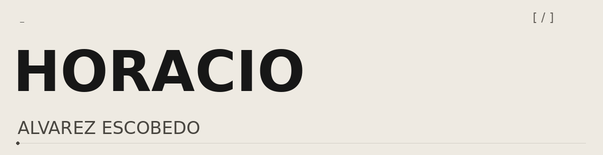
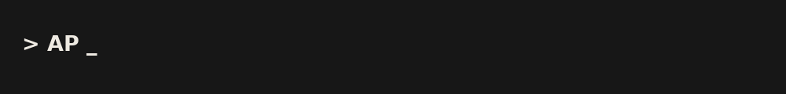
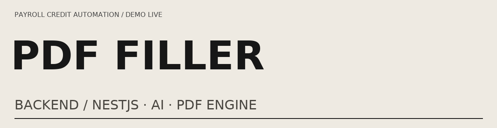
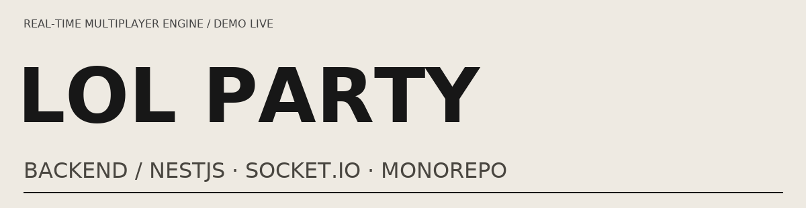
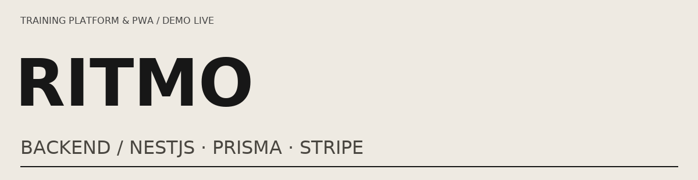

<!-- GitHub Profile of Horacio Alvarez Escobedo. -->

<table><tr><td width="30%"></td><td><h2>Building from the backend up.</h2>
Software Engineering student and Backend TypeScript developer building production-ready NestJS APIs, PostgreSQL systems, real-time WebSocket engines, and AI-powered workflows.

</td></tr></table>
<h2>Featured projects</h2>
<table><tr><td width="50%"><h3>PDF Filler</h3>
Payroll credit contract automation backend: multimodal AI document extraction, financial calculation, AcroForm PDF generation, remote signing, and RBAC control desk.

<code>DEMO LIVE</code>

<code>NestJS · TypeScript · Prisma · PostgreSQL · Gemini AI · Zod · pdf-lib · Cloudinary · Docker</code>

 

<a href="proyectos/pdf-filler/README.md">View project case study →</a>
</td><td width="50%"><h3>LoL Party</h3>
Real-time multiplayer minigame platform (9 minigames in a deterministic engine) powered by authoritative WebSockets, room locking, and typed monorepo contracts.

<code>DEMO LIVE</code>

<code>NestJS · Socket.IO · TypeScript · Node.js · Zod · Cloudflare R2 · Docker</code>

 

<a href="proyectos/lol-party/README.md">View project case study →</a>
</td></tr></table>
<table><tr><td><h3>RITMO</h3>
Training platform backend and PWA connecting trainers and athletes through workout routines, set/PR tracking, one-time linking tokens, and Stripe subscriptions.

<code>DEMO LIVE</code>

<code>NestJS · TypeScript · Prisma · PostgreSQL · Stripe · Zod · Jest · Docker · Nginx</code>

 

<a href="proyectos/ritmo/README.md">View project case study →</a>
</td></tr></table>
<h2>Tech stack</h2>

<h3>Backend</h3>

<h3>Databases &amp; ORM</h3>

<h3>Testing &amp; Documentation</h3>

<h3>Containers &amp; Cloud</h3>

<h3>Version Control &amp; Automation</h3>

<h2>Contributions</h2>

  Horacio Alvarez Escobedo / Backend 
  <a href="mailto:horacio-alvarez@k4yzer4.dev">horacio-alvarez@k4yzer4.dev</a>

