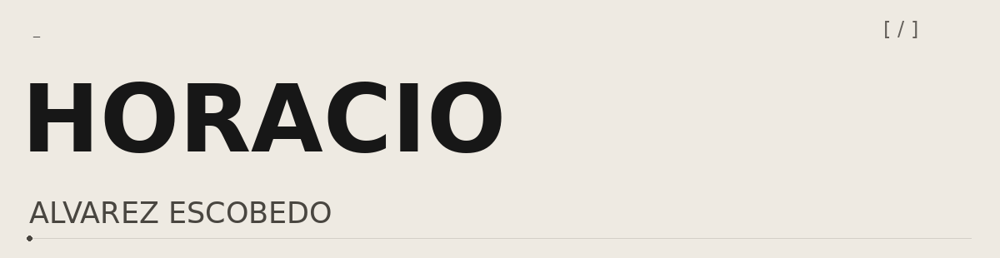
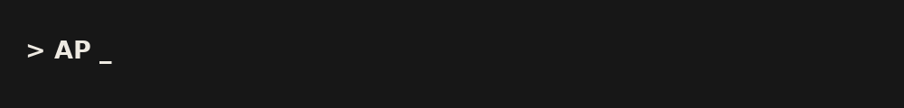
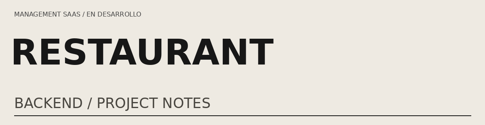
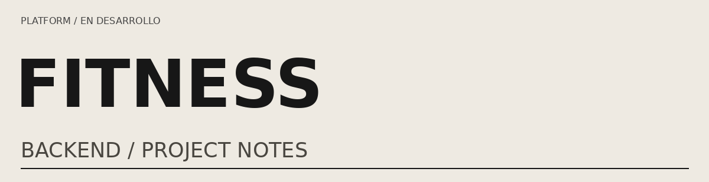

<!-- Perfil GitHub de Horacio. Consulta GUIA.md antes de publicar. -->

<table><tr><td width="30%"></td><td><h2>Construir desde el backend.</h2>
Estudiante de Ingeniería de Software. Desarrollo backends con TypeScript y NestJS para proyectos SaaS de restaurantes y entrenamiento.

</td></tr></table>
<h2>Productos en construcción</h2>
<table><tr><td width="50%"><h3>Restaurant Management SaaS</h3>
Backend orientado a conectar la experiencia del cliente con la operación del restaurante.

En desarrollo

<code>NestJS · Prisma · PostgreSQL</code>

<a href="proyectos/restaurant-management/README.md">Ver ficha del proyecto →</a>
</td><td width="50%"><h3>Fitness Platform</h3>
Backend para organizar la relación entre entrenadores, alumnos y planes de entrenamiento.

En desarrollo

<code>NestJS · Prisma · PostgreSQL · Stripe</code>

<a href="proyectos/fitness-platform/README.md">Ver ficha del proyecto →</a>
</td></tr></table>
<h2>Mi stack de trabajo</h2>
<!-- Una columna, sin tabla ni CSS responsive: versión para GitHub. Conserva solo herramientas que puedas explicar y demostrar. -->

<h3>Backend</h3>

<h3>Bases de datos y ORM</h3>

<h3>Testing y documentación</h3>

<h3>Contenedores y cloud</h3>

<h3>Control de versiones y automatización</h3>

<h2>Contribuciones</h2>

Horacio Alvarez Escobedo / Backend

<!-- Añade aquí LinkedIn y correo solo cuando decidas hacerlos públicos. -->
