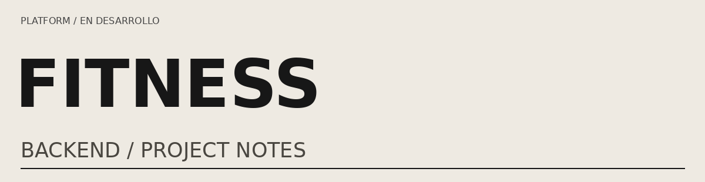
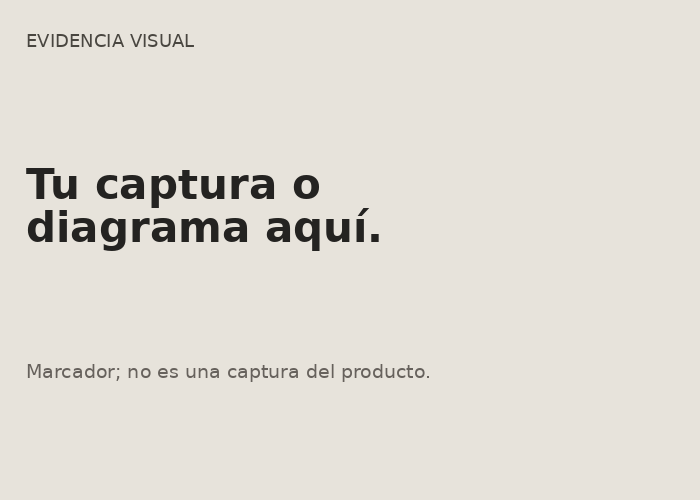

<!-- EDITAR: elimina campos entre corchetes e instrucciones antes de compartir como ficha terminada. -->

<a href="../../README.md">← Volver al perfil</a>

<h1>Fitness Platform</h1><blockquote>Backend para organizar la relación entre entrenadores, alumnos y planes de entrenamiento.</blockquote>
<table><tr><td width="35%"></td><td><h3>El proyecto de un vistazo</h3>
Autor: Horacio Alvarez Escobedo

Estado: En desarrollo

Periodo: [Inicio — última actualización]

Mi rol: [Individual / equipo y contribución concreta]

Stack de referencia: NestJS · Prisma · PostgreSQL · Stripe
</td></tr></table>

Código: [Añadir URL real] · Demo o video: [Añadir URL real] · API: [Añadir URL real]

<!-- Cuando existan, convierte lo anterior en enlaces: <a href="URL_REAL">Ver código</a>. No publiques destinos ficticios. -->

Ficha inicial basada en el alcance del proyecto. El estado de implementación debe verificarse en el repositorio.

<h2>01 / El problema y la solución</h2>
Backend para organizar la relación entre entrenadores, alumnos y planes de entrenamiento.

[Explica quién lo utiliza, qué flujo necesitaba resolver y qué puede hacer hoy. Distingue solución implementada de objetivos futuros.]

<h2>02 / Mi contribución</h2><ul><li>[Módulo o flujo que desarrollaste y enlace al código]</li><li>[Decisión que tomaste y motivo]</li><li>[Prueba o integración que verificaste]</li></ul>
[Si fue en equipo, delimita tu trabajo. Si utilizaste IA, puedes describir su apoyo y qué revisaste y comprobaste tú.]

<h2>03 / Funcionalidades y estado real</h2><table><tr><th>Área del proyecto</th><th>Estado</th><th>Evidencia</th></tr><tr><td>Gestión de usuarios, entrenadores y alumnos</td><td>Por documentar</td><td>[Añadir evidencia]</td></tr><tr><td>Planes y rutinas de entrenamiento</td><td>Por documentar</td><td>[Añadir evidencia]</td></tr><tr><td>Autenticación y suscripciones</td><td>Por documentar</td><td>[Añadir evidencia]</td></tr></table>
Estados sugeridos: implementado, parcial o pendiente. No marques terminado lo que no puedas demostrar.

<h2>04 / Arquitectura y tecnologías</h2>
[Añade un diagrama real y explica el recorrido de una petición: cliente → autorización → servicio → datos o integración → respuesta.]
<table><tr><th>Tecnología</th><th>Uso en este proyecto</th><th>Motivo</th></tr><tr><td>[Tecnología real]</td><td>[Qué parte implementa]</td><td>[Por qué la elegiste]</td></tr></table>
[Supabase, Neon y otras herramientas del perfil no se atribuyen automáticamente a este proyecto. Incluye solo las utilizadas aquí.]

<h2>05 / Decisiones y retos técnicos</h2><h3>[Reto concreto]</h3><ul><li>Problema: [restricción o caso que podía fallar].</li><li>Opciones: [alternativas realmente consideradas].</li><li>Implementación: [solución y enlace al código].</li><li>Verificación: [prueba o pasos reproducibles].</li><li>Limitación: [qué caso sigue sin resolver].</li></ul>
<h2>06 / Pruebas y evidencia</h2><table><tr><th>Caso</th><th>Tipo</th><th>Cómo comprobarlo</th></tr><tr><td>[Flujo válido]</td><td>[Unitaria / integración / e2e / manual]</td><td>[Archivo o pasos]</td></tr><tr><td>[Permiso o error]</td><td>[Tipo real]</td><td>[Archivo o pasos]</td></tr></table>
[Si no hay pruebas automatizadas, indícalo. Para métricas, añade entorno, herramienta, carga, duración y fecha. No inventes cobertura ni rendimiento.]

<h2>07 / Cómo probarlo</h2><h3>Demo o video</h3>
[Enlace real y limitaciones. Usa datos de prueba; no publiques credenciales reales ni permisos administrativos.]
<h3>Ejecución local</h3><ol><li>[Versiones y requisitos]</li><li>[Clonar el repositorio del código, no el del perfil]</li><li>[Instalación verificada]</li><li>[Variables a partir de .env.example, sin secretos]</li><li>[Migraciones y datos de prueba]</li><li>[Comandos comprobados para iniciar y probar]</li></ol><h3>Flujo de evaluación</h3><ol><li>[Acción inicial]</li><li>[Acción que muestra la regla de negocio]</li><li>[Resultado esperado]</li><li>[Caso de error y respuesta esperada]</li></ol>
<h2>08 / Limitaciones y próximos cambios</h2><ul><li>Limitación actual: [qué falta].</li><li>Próxima mejora: [cambio concreto y motivo].</li><li>Fuera de alcance: [qué no se intentó resolver].</li></ul>
<h2>09 / Qué aprendí</h2>
[Una lección concreta, el error o descubrimiento que la originó y cómo cambió tu implementación.]

<a href="../../README.md">← Volver al perfil</a> · <a href="../restaurant-management/README.md">Ver el otro proyecto →</a>

