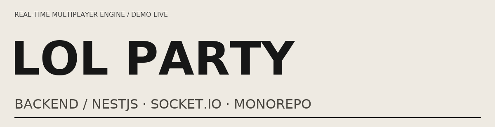

<a href="../../README.md">← Back to profile</a>

<h1>LoL Party</h1>
<blockquote>Real-time multiplayer minigame platform (9 minigames in a deterministic engine) powered by authoritative WebSockets, room locking, and typed monorepo contracts.</blockquote>

  
  &nbsp;
  

<strong>Repository:</strong> <a href="https://github.com/K4YZER4/lol-minigames" target="_blank">Monorepo (GitHub)</a>

<table>
  <tr>
    <th>Field</th>
    <th>Details</th>
  </tr>
  <tr>
    <td><strong>Author</strong></td>
    <td>Horacio Alvarez Escobedo</td>
  </tr>
  <tr>
    <td><strong>Status</strong></td>
    <td><code>DEMO LIVE</code></td>
  </tr>
  <tr>
    <td><strong>Case Study &amp; Demo</strong></td>
    <td><a href="https://lol-party.k4yzer4.dev/portafolio" target="_blank">lol-party.k4yzer4.dev/portafolio</a></td>
  </tr>
  <tr>
    <td><strong>Stack</strong></td>
    <td><code>NestJS · Socket.IO · TypeScript · Node.js · Zod · Cloudflare R2 · Docker</code></td>
  </tr>
</table>

<h2>01 / Overview</h2>

Authoritative real-time multiplayer platform hosting 9 synchronized minigames inside a deterministic, server-driven engine. Built as a strictly typed monorepo with shared runtime contracts, anti-cheat media proxying, and automated unit and end-to-end test suites.

<h2>02 / Architecture &amp; Engineering Highlights</h2>
<table>
  <tr>
    <th>#</th>
    <th>Area</th>
    <th>Implementation Details</th>
  </tr>
  <tr>
    <td><code>01</code></td>
    <td><strong>Authoritative Real-Time Gateway</strong></td>
    <td>NestJS 12 + Socket.IO server using per-room locking (<code>withRoomLock</code>) against race conditions, token reconnection, and bounce-free host handover.</td>
  </tr>
  <tr>
    <td><code>02</code></td>
    <td><strong>Deterministic Game Engine (<code>packages/engine</code>)</strong></td>
    <td>9 minigames written as pure functions with seeded PRNG, 250ms server tick, and strict public/private state projection per player.</td>
  </tr>
  <tr>
    <td><code>03</code></td>
    <td><strong>Anti-Cheat Proxy &amp; Network Security</strong></td>
    <td>Opaque media proxy for ability icons and audio clips so answers never leak in DevTools, tiered rate limiting, and Cloudflare IP validation.</td>
  </tr>
  <tr>
    <td><code>04</code></td>
    <td><strong>End-to-End Contracts &amp; Automated Tests</strong></td>
    <td>Shared Zod 4 schemas in <code>packages/protocol</code>, 74+ automated unit tests, and a 43-check real-server E2E suite.</td>
  </tr>
</table>

<h2>03 / Live Demo Notes</h2>
<blockquote>The portfolio page includes a full architecture walkthrough, demo video, and direct access to launch private multiplayer rooms.</blockquote>

<a href="../../README.md">← Back to profile</a> · <a href="../ritmo/README.md">Next project: RITMO →</a>

