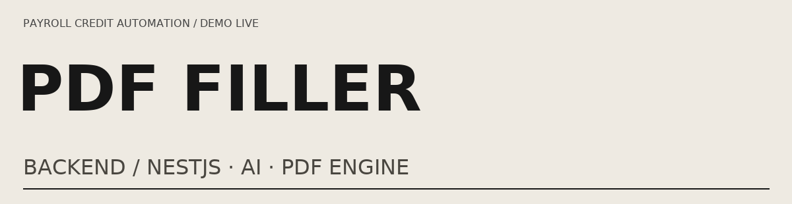

<a href="../../README.md">← Back to profile</a>

<h1>PDF Filler</h1>
<blockquote>Payroll credit contract automation backend: multimodal AI document extraction, financial calculation, AcroForm PDF generation, remote signing, and RBAC control desk.</blockquote>

  
  &nbsp;
  

<strong>Repositories:</strong> <a href="https://github.com/K4YZER4/portafolio-backend/tree/main/PDF-FILLER">Backend (NestJS)</a> · <a href="https://github.com/K4YZER4/PDF-FILLER-FRONTEND">Frontend</a>

<table>
  <tr>
    <th>Field</th>
    <th>Details</th>
  </tr>
  <tr>
    <td><strong>Author</strong></td>
    <td>Horacio Alvarez Escobedo</td>
  </tr>
  <tr>
    <td><strong>Status</strong></td>
    <td><code>DEMO LIVE</code></td>
  </tr>
  <tr>
    <td><strong>Live Demo</strong></td>
    <td><a href="https://pdf-filler.k4yzer4.dev">pdf-filler.k4yzer4.dev</a></td>
  </tr>
  <tr>
    <td><strong>Stack</strong></td>
    <td><code>NestJS · TypeScript · Prisma · PostgreSQL · Gemini AI · Zod · pdf-lib · Cloudinary · Docker</code></td>
  </tr>
</table>

<h2>01 / Overview</h2>

End-to-end backend system built to automate payroll credit contract workflows—from extracting client data out of identity and income documents with multimodal AI, to computing amortization tables, generating filled multi-page AcroForm PDFs, and managing secure remote signing with role-based auditing.

<h2>02 / Architecture &amp; Engineering Highlights</h2>
<table>
  <tr>
    <th>#</th>
    <th>Area</th>
    <th>Implementation Details</th>
  </tr>
  <tr>
    <td><code>01</code></td>
    <td><strong>Multimodal AI Document Extraction</strong></td>
    <td>Unified INE, payroll stub, and bank statement OCR via Google Gemini AI with Zod schema validation and CURP verification.</td>
  </tr>
  <tr>
    <td><code>02</code></td>
    <td><strong>Credit Table &amp; Multi-Page PDF Engine</strong></td>
    <td>Amortization and CAT calculation from Excel tables (<code>exceljs</code>), AcroForm filling (<code>pdf-lib</code>), and handwritten signature stamping stored in Cloudinary.</td>
  </tr>
  <tr>
    <td><code>03</code></td>
    <td><strong>Secure Remote Signing Flow</strong></td>
    <td>Expiring one-time signing links (<code>TokenFirma</code>), optional 6-digit OTP verification, and an anti-SSRF PDF proxy blocking private IP ranges.</td>
  </tr>
  <tr>
    <td><code>04</code></td>
    <td><strong>Control Desk RBAC &amp; Production Hardening</strong></td>
    <td>JWT auth with <code>ASESOR</code>/<code>ADMIN</code> roles, PostgreSQL trigger-backed state machine and audit history, token-bucket rate limiting, Helmet, and pino logs.</td>
  </tr>
</table>

<h2>03 / Live Demo Notes</h2>
<blockquote>Runs in public <code>DEMO_MODE</code> with an anonymized contract template (<code>contrato_demo.pdf</code>) and optional visitor <code>X-Gemini-Api-Key</code>.</blockquote>

<a href="../../README.md">← Back to profile</a> · <a href="../lol-party/README.md">Next project: LoL Party →</a>

