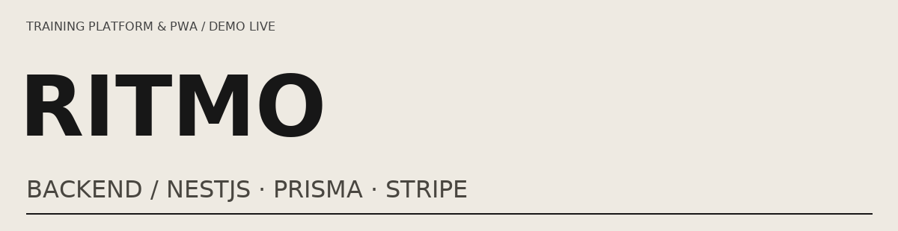

<a href="../../README.md">← Back to profile</a>

<h1>RITMO</h1>
<blockquote>Training platform backend and PWA connecting trainers and athletes through workout routines, set/PR tracking, one-time linking tokens, and Stripe subscriptions.</blockquote>

  
  &nbsp;
  

<strong>Repositories:</strong> <a href="https://github.com/K4YZER4/RITMO">Repository (GitHub)</a> · <a href="https://github.com/K4YZER4/portafolio-backend">Deploy Infra (Docker + Nginx)</a>

<table>
  <tr>
    <th>Field</th>
    <th>Details</th>
  </tr>
  <tr>
    <td><strong>Author</strong></td>
    <td>Horacio Alvarez Escobedo</td>
  </tr>
  <tr>
    <td><strong>Status</strong></td>
    <td><code>DEMO LIVE</code></td>
  </tr>
  <tr>
    <td><strong>Live Demo</strong></td>
    <td><a href="https://ritmo.k4yzer4.dev">ritmo.k4yzer4.dev</a></td>
  </tr>
  <tr>
    <td><strong>Stack</strong></td>
    <td><code>NestJS · TypeScript · Prisma · PostgreSQL · Stripe · Zod · Jest · Docker · Nginx</code></td>
  </tr>
</table>

<h2>01 / Overview</h2>

Full-stack training platform and PWA connecting coaches and athletes with structured workout routines, session logging, automatic personal record (PR) tracking, single-use coach-athlete linking tokens, and Stripe subscription billing.

<h2>02 / Architecture &amp; Engineering Highlights</h2>
<table>
  <tr>
    <th>#</th>
    <th>Area</th>
    <th>Implementation Details</th>
  </tr>
  <tr>
    <td><code>01</code></td>
    <td><strong>Multi-Schema PostgreSQL Architecture</strong></td>
    <td>Relational model with Prisma 7 organized across 5 PostgreSQL schemas (<code>core</code>, <code>app_user</code>, <code>entrenador</code>, <code>alumno</code>, <code>ubi</code>) and versioned migrations.</td>
  </tr>
  <tr>
    <td><code>02</code></td>
    <td><strong>Training Domain &amp; Automatic PR Tracking</strong></td>
    <td>Routine scheduling with date-overlap resolution, plan-limited custom exercises, session logging, and automatic personal record calculation.</td>
  </tr>
  <tr>
    <td><code>03</code></td>
    <td><strong>Authentication &amp; One-Time Linking</strong></td>
    <td>Global JWT guard (<code>@Public</code> / <code>@CurrentUser</code>), expiring single-use trainer-to-student linking tokens, and strict Zod environment validation.</td>
  </tr>
  <tr>
    <td><code>04</code></td>
    <td><strong>Stripe Subscriptions &amp; Multistage Deploy</strong></td>
    <td>Stripe Checkout plus idempotent webhooks with event deduplication; deployed via Vercel and a multistage Docker + Nginx proxy on Render.</td>
  </tr>
</table>

<h2>03 / Live Demo Notes</h2>
<blockquote>Public demo credentials — Trainer: <code>demo.entrenador@ritmo.app</code> | Athlete: <code>demo.alumno@ritmo.app</code> | Password: <code>RitmoDemo2026!</code> (Flow: create routine → assign → log sets → view PRs).</blockquote>

<a href="../../README.md">← Back to profile</a> · <a href="../pdf-filler/README.md">Next project: PDF Filler →</a>

